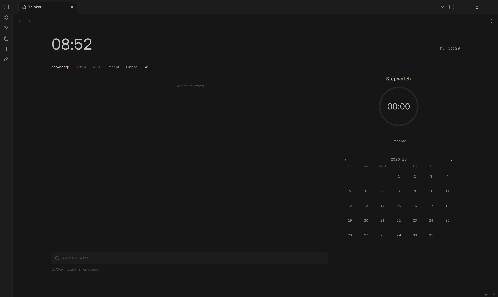

# Thinker

A start page for an Obsidian vault: a clock, the notes as an outline, a focus
timer, and a month of focus history.



## Installation

**From the community list**

1. Open `Settings → Community plugins → Browse`.
2. Search for `Thinker`, choose `Install`, then `Enable`.

**Manually, from a release**

1. Download `main.js`, `manifest.json` and `styles.css` from the latest release.
2. Create the folder `<your vault>/.obsidian/plugins/thinker/` and put the three
   files in it. The folder name must match `thinker` in `manifest.json`.
3. Restart Obsidian, then enable **Thinker** in `Settings → Community plugins`.

## Usage

1. **Open the page.** It opens on startup, replacing the note the vault restored
   rather than sitting beside it, so nothing flashes up first. You can also click
   the house icon in the left ribbon, or run `Thinker: Open home page`.
2. **Read the list.** The page opens on the first folder in the row. The range row
   lists your own folders first, then `All`, `Recent` and `Pinned`. Folders are
   headings and notes sit under them; choosing a folder shows its own notes and
   folds the subfolders into headings. A note row is the note's name and when it
   changed. Under `All` and `Recent` the row also carries the folder it lives in,
   because those two ranges have no folder headings above them; inside a folder
   the heading already says that, and `Pinned` is a shortlist you made yourself.
   A full-text hit replaces that line with a snippet of the note's own words. A row
   without that second line is 32px tall instead of 44, so the list is not a column
   of gaps with names in them; rows that keep two lines keep the taller box. The
   order of the list is set in `Settings → Thinker → Note order`: name A to Z,
   name Z to A, newest first or oldest first.
3. **Arrange the row.** The pencil beside the `+` turns the range row into
   handles: drag a tab to the left half or the right half of another to move it
   in front of or behind. The order is written to the settings, so it survives a
   restart, and a folder seen for the first time lands after the tabs already
   arranged. Clicking a tab while the mode is on is treated as a miss, not as a
   filter.
4. **Create something.** The `+` at the end of the range row opens one dialog for
   both kinds: pick `Note` or `Folder`, type a name, then pick a place from the
   vault's outline, where every folder is listed and that level is shown by text
   size. The chosen folder's path is created if it does not exist yet.
5. **Search.** The field sits under the list. Type to filter by title, alias and
   heading; `↑ ↓` to select, `Enter` to open, `Ctrl/Cmd + Enter` to create a note
   from what you typed, `Esc` to clear.
6. **Run a session.** Click the digits inside the ring to start, click again to
   end. `Pause` and `End` appear while a session runs. Every session is written to
   `FocusLog/<year>/<date>.md`. The clock keeps its own time: with the window
   minimised, the machine asleep, or Obsidian closed outright, the seconds still
   accrue and are added back the moment the page returns, still running. An
   interruption longer than twelve hours is not counted, so a timer left running
   overnight is not filed as a night-long session.
7. **Check the month.** Click a day in the calendar to see, add, edit or delete
   that day's sessions, and to open or create its diary note.
8. **Look at the numbers.** Click the bar-chart icon in the left ribbon to open
   the statistics panel in the right sidebar. It switches between day, week and
   month, and lists where the time went.
9. **Change the settings.** The gear in the left ribbon opens Obsidian's settings
   at this plugin's own tab, without going through the settings root.

## Requirements and permissions

- Desktop only in this release.
- Reads the vault to build the note index. Writes two kinds of file: the daily
  focus log under the configured folder, and notes the user asks for.
- No network access, no external process, no telemetry.

## Data

One Markdown file per day at `FocusLog/<year>/<date>.md`, with a YAML header and
a JSON block. The format matches the older Thinkers plugin, so records written by
either one are readable by the other.

## Known limits

- Records are rewritten per day; two devices editing the same day keeps the last
  write.
- Full-text search builds a cache in the background. On a large vault the first
  pass takes a while; title search works throughout.
- Folders only. Tags are not used for grouping.

## Support

Optional, and only that. Thinker is free, every feature is free, and nothing here
is locked behind a payment. The two codes are WeChat and Alipay, for anyone who
wants to send something back.

<p>
  
  
</p>

Licensed under the MIT License.

---

# Thinker

Obsidian 起始页插件。单页包含时钟、笔记、计时与日历四个区域。
计时与记录格式沿用 Thinkers，历史数据直接可用。


## 安装

将整个文件夹置于库的插件目录：

```
<库>/.obsidian/plugins/thinker/
├─ manifest.json
├─ main.js
└─ styles.css
```

文件夹名须为 `thinker`，与 manifest 中的 id 一致。放置后在 设置 → 第三方插件 中刷新并启用。

PowerShell 复制命令：

```powershell
$src = "C:\Users\Depth\Desktop\Study\Other\Obsidian\Thinker"
$dst = "C:\Users\Depth\Documents\Depthinker\.obsidian\plugins\thinker"
New-Item -ItemType Directory -Force -Path $dst | Out-Null
Copy-Item "$src\*" $dst -Recurse -Force
```

## 启用前

Thinker 与旧插件 `thinkers` 写入同一批 `FocusLog/<年>/<日期>.md`。两者同时启用会导致同一次计时被记录两次。
启用 Thinker 前须停用 `thinkers`。`thinkers-tomatodo` 亦可停用，联动功能已并入本插件。

## 界面

左栏为笔记，占七成宽度；右栏放置计时与日历。
整页最大宽度 1400、最大高度 720，超出部分留白，不随屏幕放大拉伸。
左右顺序在 设置 → 左右顺序 中调整，界面不设切换按钮。

## 笔记列表

文件夹为列表中的行，笔记列于所属文件夹之下。层级由标题字号表达，笔记不缩进。

```
数学                    3
  总览                 8 分钟前
  微积分                1
    极限小结           2 小时前
  线代                  1
    傅里叶变换         1 分钟前
English                 1
  长难句拆解           2 小时前
```

一级文件夹 15px，二级 13px，三级及以下 12px。点击文件夹可折叠该分支，折叠后仅保留文件夹行。

笔记行只显示名称与修改时间。全部与最近两档没有文件夹行，名称下面补一行所在路径，否则不知道笔记在哪个目录；其它分类的路径已由上方文件夹行表达，不再重复，根目录的笔记在全部里显示为「根目录」。全文搜索命中时，这一行改为正文片段。没有路径的分类行高从 44 收到 32，免得名字下面空出一块；带路径的行与带片段的两行行高不变。

顶部分类行先列库内文件夹，再列全部 / 最近 / 收藏。打开页面时默认选中第一个文件夹，按当前排序的第一项；库里没有文件夹时落在全部。输入搜索内容时列表转为平铺结果，清空后恢复。

排序在 设置 → 笔记排序 中选定，四档：名称 A → Z、名称 Z → A、时间 新 → 旧、时间 旧 → 新。文件夹顺序随名称方向，时间档对文件夹不适用，仍按名称升序。搜索时按匹配度排序，结果不受该设置影响。

设置 → 隐藏的文件夹 可排除指定目录，子目录一并排除，不进入索引。

添加到收藏的笔记不再浮到列表顶部，避免打乱所选顺序。收藏仍是独立的分类。

新建时点分类行末尾的 `+`，弹窗里有三件事：类型（笔记或文件夹）、名称、位置。位置按库内目录列出，空文件夹也会出现，层级高的字号大、层级低的字号小，不缩进。目标目录不存在时会逐级建好再放进去。

`+` 右边的笔形按钮把分类行切到排序模式：标签变成可拖动的把手，按住拖到别的标签左半边之前、右半边之后，松手即生效。再次点笔退出。顺序存进设置，重开页面不变；新出现的文件夹排在已排过的标签之后。排序模式下点标签只当作没点中，不会切换分类。

## 键盘

| 位置 | 按键 | 行为 |
| --- | --- | --- |
| 搜索框 | 输入 | 按标题、别名、小标题筛选；启用全文后包含正文 |
| 搜索框 | ↑ ↓ | 选择 |
| 搜索框 | Enter | 打开选中笔记 |
| 搜索框 | Ctrl / Cmd + Enter | 以当前输入创建笔记，不弹窗 |
| 分类行 + | 点击 | 弹窗选择新建笔记或文件夹，并指定位置 |
| 分类行 笔 | 点击 | 进入或退出标签排序模式 |
| 弹窗 | Enter | 创建 |
| 弹窗 | 点击位置行 | 更换新建位置 |
| 搜索框 | Esc | 清空 |
| 笔记行 | 点击 | 打开 |
| 笔记行 | Ctrl / Cmd + 点击 | 新标签页打开 |
| 笔记行 | 右键 | 新标签页打开、重命名、复制路径、删除 |
| 计时圆环 | 点击数字 | 开始；再次点击结束 |
| 计时圆环 | 点击模式名 | 空闲时切换番茄钟与正计时 |
| 日历 | 点击日期 | 查看当日记录，可增删改，可打开或创建日记 |
| 统计 | 点击柱形或日期格 | 切换至该日 |

## 命令

- `Thinker: 打开主页`
- `Thinker: 开始或结束一次专注`
- `Thinker: 新建笔记`
- `Thinker: 添加记录`
- `Thinker: 打开今日日记`
- `Thinker: 打开专注统计`

左侧功能区三个入口：房屋图标打开主页，柱状图标在右栏打开统计，齿轮图标直接打开本插件的设置页。

## 计时

支持番茄钟与正计时。番茄钟完成后生成一条记录，达到设定轮数进入长休息。自动进入下一阶段可关闭。

计时自己走：窗口最小化、系统休眠、或 Obsidian 被关掉，秒数照常累加，页面回来时补齐并接着跑。中断超过十二小时不再补，所以忘关的计时器不会变成一整夜的记录。

结束后默认询问本次内容，填写内容作为标签，统计按标签汇总。可在设置中关闭。

## 统计

控制行 `‹ 10.26 – 11.01 ›` 前后翻动一个周期，点击中间日期返回今日。
下方 `日 / 周 / 月` 三个页签，翻页步长随粒度变化。

三项数值：合计、次数、日均。日粒度下第三项替换为最长记录。

图形随粒度切换：

- 周：七根柱形，今日满色
- 月：月历热力，四档深浅
- 日：24 小时时间轴，一段对应一次计时

底部按标签汇总占比，最多五项，休息单列。

## 数据

格式与 Thinkers 一致，两个插件可互相读取：

```markdown
---
thinkers: log
date: 2026-10-28
focus-minutes: 72
session-count: 1
rest-minutes: 0
rest-count: 0
---

```json
[
	{"id":"...","kind":"focus","mode":"stopwatch","tag":"经济学","start":1792026120000,"end":1792030440000,"durationSec":4320,"completed":true,"createdAt":0,"updatedAt":0}
]
```
```

## 已知限制

- 本版本仅支持桌面端。
- 全文搜索在后台分块读取文件。库较大时首次建立缓存需要等待，期间标题搜索正常可用。
- 记录按日整文件重写。多台设备同时修改同一天时，以最后写入为准。
- 分类依据文件夹，不读取标签。库根目录下的笔记归入「根目录」。

## 支持

可选，仅此而已。插件免费，全部功能免费，没有任何一项放在付款后面。两个码分别是微信与支付宝，愿意回一点心意就扫，不必勉强。

<p>
  
  
</p>

