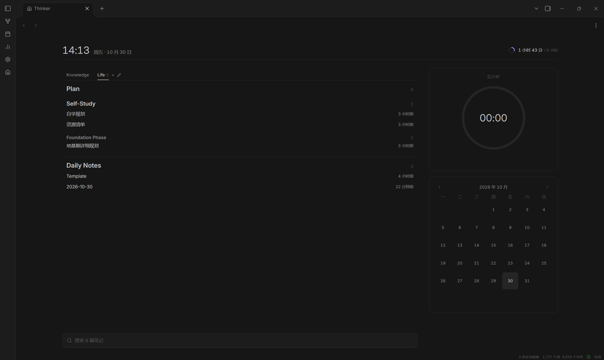

# Thinker

A start page for Obsidian: a clock, the vault's notes as an outline, a focus timer, and a month of focus history.

Obsidian 起始页插件：一个视图里放着时钟、笔记清单、专注计时器和一张月历。



| Item / 项 | Value / 内容 |
| --- | --- |
| Plugin id / 插件 id | `thinker` |
| Version / 版本 | 3.3.2 |
| Minimum Obsidian / 最低版本 | 1.13.0 |
| Platform / 平台 | Desktop only / 仅桌面端 |
| Author / 作者 | Depthinker |
| Data folder / 数据目录 | `FocusLog` |

---

## Buy me a coffee (optional)  |  支持作者（可选）
| Alipay 支付宝 | WeChat Pay 微信 |
| --- | --- |
|  |  |

---
## English

### Install

Download `main.js`, `manifest.json` and `styles.css`, put them in `<vault>/.obsidian/plugins/thinker/`, then enable Thinker under Community plugins. After an update, reload the plugin; settings and records are read from `data.json` as before.

### Page

Thinker registers one view. It opens with Obsidian and collapses the left sidebar so the page fills the window. It closes like any other tab. Both come with their own switch.

The top line is one answer: the clock, the date, and today's focus against the daily goal. The clock hides seconds by default, since a digit that moves every second pulls the eye back.

Below it are two columns, notes on the left or on the right. The side column holds the timer first and the calendar under it.

### Notes

The list is built from markdown files in the vault, grouped by folder. The index can be limited to a few roots; leave it empty to index everything.

Chips along the top are the folders themselves plus three ranges that cross folders: All, Recent, Pinned. Pinned notes come from a path list typed into the settings.

Search runs over titles or over full text, and full-text hits show a snippet. Order is by name or by modified time, each ascending or descending; Recent stays on newest first. A cap keeps the list short, hidden folders stay out, and every row carries its relative modified time. The context menu opens a note in a new tab, renames it, copies its path, or deletes it.

### Timer

Two modes: pomodoro and stopwatch. Stopwatch counts up until it is ended; pomodoro counts down the configured focus block of 25 minutes, then a 5 minute short break, a 15 minute long break every four rounds. Auto cycle can be turned off.

The digits are the control: one press starts a session, the next press ends it. Pause and end sit under the dial and only appear while a session is running.

The ring measures the session. Pomodoro draws the block counting down; the stopwatch laps once an hour and starts a new lap, because an unbounded duration has to be given some window before it can be drawn at all.

A session ends with a chime. Vibration and system notices are switches of their own. Sessions shorter than the configured floor are not written. A record dialog opens after each round, for a tag or for skipping it.

### Calendar

A month grid draws every day as a square box and fills it by that day's focus, in four steps: the daily goal is the last step, and a day past the goal keeps it. Empty days keep the frame and the palest fill. Opening a day lists its records one by one, and a session that was missed can be added by hand. The diary for that day opens from the same panel.

### Statistics

The statistics view lives in the right sidebar and switches between day, week and month. It shows the total for the period, session count, daily average, focus and rest time, and the longest session.

### Daily notes

Folder, date format and template come from the core Daily notes plugin. With nothing configured, the file lands in the vault root named `YYYY-MM-DD`, and a missing file is created from the template.

### Data

One markdown file per day under `FocusLog`. The frontmatter carries the totals, the body is a json array with one record per line. An example:

```yaml
---
thinkers: log
date: 2026-10-30
focus-minutes: 95
session-count: 3
rest-minutes: 20
rest-count: 3
---
```

```json
{"id":"m4t8x1","kind":"focus","mode":"pomodoro","phase":"focus","tag":"","start":1793340000000,"end":1793341500000,"durationSec":1500,"completed":true,"createdAt":1793340000000,"updatedAt":1793341500000}
```

`kind` is `focus` or `rest`, `mode` is `pomodoro` or `stopwatch`, and `start` and `end` are epoch milliseconds. Deleted records stay in the file marked `deleted: true` and are skipped in every total.

### Commands

| Id | Name |
| --- | --- |
| `open-home` | Open the Thinker home page |
| `start-stop` | Start or end a session |
| `new-note` | New note from the home page |
| `add-session` | Add a session by hand |
| `open-diary` | Open today's diary |
| `open-stats` | Open focus statistics |

### Changelog

#### 3.4.0

A redesign of the start page, with the same data, the same commands and the same settings.

The page is now read by how often a question is asked. Where the day stands comes first, as one line: the clock, the date, and today's focus against the daily goal. What to start comes second: the notes column, and the timer as the first card of the side column. How the month went comes last.

The notes column lost its footer hint, and the timer lost its caption. Neither was reading; both were teaching something the page already showed.

The digits are the control again: a press starts, a press ends. Pause and end appear under the dial only while a session runs.

The ring measures the session rather than the day. A day ring against a six hour goal moves one degree every eight minutes, which is indistinguishable from a broken one, so the day's total moved to the status line where a slow gauge belongs, and the dial went back to what it is good at: showing that something is moving. Pomodoro counts its block down; the stopwatch laps every hour.

Under the surface: the stylesheet was rebuilt on one token layer with a single fallback for `color-mix`, the button reset and the components that size themselves now sit on the same footing instead of one silently flattening the other, reduced motion reaches the tokens it claims to cover, and the aggregate transition block that was swallowing two-property transitions is gone.


### Compatibility

`data.json` keeps the same shape as 3.3.2, so an in-place upgrade needs no migration. Records are read from the same `FocusLog` files. The plugin needs Obsidian 1.13.0 or newer and does not run on mobile.

---

## 中文

### 安装

下载 `main.js`、`manifest.json`、`styles.css` 三个文件，放进 `<库>/.obsidian/plugins/thinker/`，在第三方插件里启用 Thinker。升级时覆盖这三个文件并重新加载插件，设置和记录仍从 `data.json` 读。

### 页面

Thinker 只注册一个视图。它随 Obsidian 启动打开，打开时收起左侧边栏让页面占满窗口，也可以像普通标签页一样关掉；启动打开与收起边栏各有一个开关。

最上面一行同时回答两件事：时钟、日期、今日专注对每日目标。时钟默认不显示秒，因为每秒跳动的数字会把视线不断拉回去。

下面分两栏，笔记在左或在右。右栏从上到下是计时器与日历，计时器在前。

### 笔记清单

清单由库内的 markdown 文件按文件夹分层。索引范围可以限定到几个目录，留空则覆盖全库。

顶部一行是分类：文件夹分类对应真实目录，另外三个跨目录，分别是全部、最近、收藏。收藏来自设置里手填的路径列表。

搜索可在标题与全文之间切换，全文命中会带出片段。排序有名称与修改时间，各自可升可降；最近一栏固定按时间倒序。列表有条数上限，隐藏目录不进清单，每行右侧是相对修改时间。右键菜单可以新标签页打开、重命名、复制路径、删除。

### 计时器

两种模式，番茄钟与正计时，默认番茄钟。番茄钟默认 25 分钟专注、5 分钟短休、15 分钟长休，每 4 轮进一次长休，自动循环可关。正计时往上走，按结束才停。

数字就是控件：按一下开始，再按一下结束。暂停与结束在表盘下方，只在会话进行时出现。

表盘上的环量的是这一段。番茄钟画这一轮的倒计时；正计时每小时走一圈，从头再走，因为无上限的时长总得给一个窗口才画得出来。

一轮结束播放提示音，震动与系统通知是两个独立开关。短于设定秒数的会话不写进记录。每轮结束弹出记录窗口，补标签或直接略过。

### 日历

月历把每天画成一个方格，按当天专注时长分四档填色：每日目标就是最深的一档，超过目标仍停在这一档。没有记录的日子留着框和最淡的一层底色。点开某一天看当天逐条记录，漏掉的会话可以手动补记，当天的日记也从这里打开。

### 统计

右侧栏另有一个统计视图，按日、周、月切换，显示本期合计、会话数、日均、专注与休息时长，以及最长的一次。

### 日记

日记的目录、日期格式和模板跟随 Obsidian 核心日记插件。核心插件没配时，文件落在库根目录，以 `YYYY-MM-DD` 命名；文件不存在就按模板新建。

### 数据

专注记录写在 `FocusLog` 目录，一天一个 markdown 文件。文件头带总数，正文是 json 数组，一条记录一行。一个示例：

```yaml
---
thinkers: log
date: 2026-10-30
focus-minutes: 95
session-count: 3
rest-minutes: 20
rest-count: 3
---
```

```json
{"id":"m4t8x1","kind":"focus","mode":"pomodoro","phase":"focus","tag":"","start":1793340000000,"end":1793341500000,"durationSec":1500,"completed":true,"createdAt":1793340000000,"updatedAt":1793341500000}
```

`kind` 为 `focus` 或 `rest`，`mode` 为 `pomodoro` 或 `stopwatch`，`start` 与 `end` 是毫秒时间戳。删掉的记录留在文件里，标 `deleted: true`，统计时跳过。

### 命令

| 命令 id | 名称 |
| --- | --- |
| `open-home` | 打开 Thinker 主页 |
| `start-stop` | 开始或结束一次专注 |
| `new-note` | 在主页新建笔记 |
| `add-session` | 手动添加一条记录 |
| `open-diary` | 打开今天的日记 |
| `open-stats` | 打开专注统计 |

### 更新日志

#### 3.4.0

起始页重做一遍，数据、命令、设置都不变。

页面按问题被问到的频次重排。今天到了哪一步放最上面，一行说清：时钟、日期、今日专注对每日目标。要开始什么放中间：笔记列，以及右栏第一张卡片的计时器。这个月过得怎么样放最后一层。

笔记列底部的提示与计时器下方的说明都删了。两处都在教一件页面本身已经说清的事。

数字重新成为控件：按一下开始，再按一下结束。暂停与结束只在会话进行时出现在表盘下方。

环量的是这一段，不是一整天。对着六小时的目标，环每八分钟才走一度，看上去和坏了一样；今日合计因此移到状态行，那里本来就该放一个慢速的量，表盘则回到它擅长的事：让人看见东西在动。番茄钟画这一轮的倒计时，正计时每小时走一圈，从头再走。

底层：样式表重建在一套令牌上，`color-mix` 只有一个后备分支；按钮重置与给出尺寸的组件现在站在一起，不再出现一个悄悄压平另一个；减弱动效终于改到它声称覆盖的令牌上；吞掉双属性过渡的聚合块已删除。

### 兼容

`data.json` 的格式与 3.3.2 相同，原地升级不需要迁移；记录仍从原来的 `FocusLog` 文件读。插件要求 Obsidian 1.13.0 以上，不支持移动端。